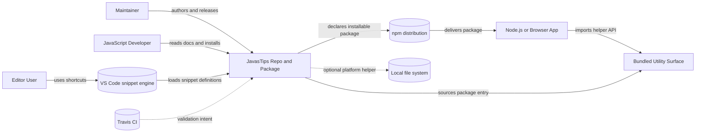
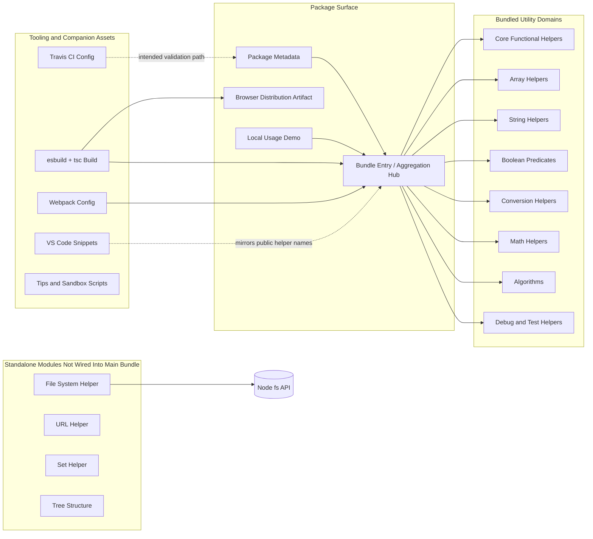
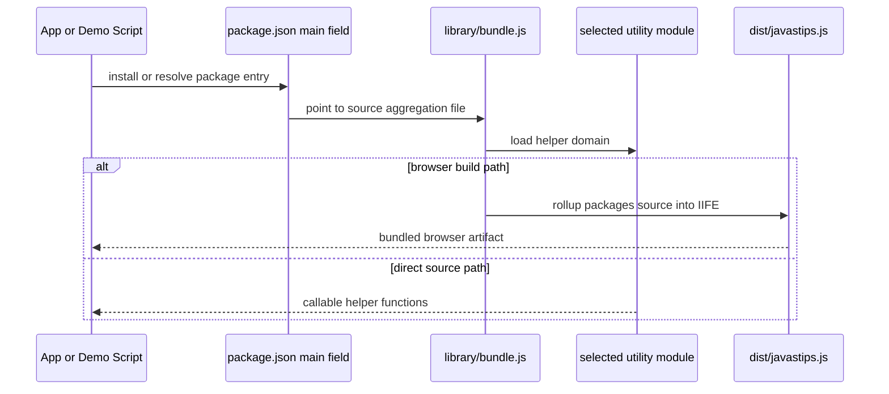

# Codebase Diagram

## Scope

- This repository is organized as a small JavaScript utility library with a source aggregation layer, packaging configs, demo scripts, and editor snippet assets.
- No API server, database, cache, queue, or worker layer was detected from the repository structure or dependency search.

## Legend

- Solid arrow: direct code dependency, build dependency, or runtime call.
- Dashed arrow: indirect, optional, or companion relationship.
- Rectangles: in-repo modules or domains.
- Rounded database-style nodes: external runtime boundary or distribution channel.

## System Context Diagram

### Code anchors

- `sys_repo`: `package.json:1`, `README.md:3`
- `sys_bundle`: `package.json:4`, `library/bundle.js:1`
- `ext_npm`: `README.md:14`, `package.json:2`
- `ext_vscode`: `extension/javastips.json:1`
- `ext_fs`: `library/FileSystem.js:1`
- `ext_ci`: `.travis.yml:1`

## Codebase Architecture Diagram

### Code anchors

- `pkg_manifest`: `package.json:1`
- `bundle_entry`: `library/bundle.js:1`
- `dist_rollup`: `dist/javastips.js:1` (built by the `build` script in `package.json`)
- `demo_main`: `library/main.js:1`
- `mod_core`: `library/javastips.js:1`
- `mod_array`: `library/Array.js:1`
- `mod_string`: `library/String.js:1`
- `mod_boolean`: `library/Boolean.js:1`
- `mod_convert`: `library/convert.js:1`
- `mod_math`: `library/math.js:1`, `library/bundle.js:34`
- `mod_algo`: `library/algorithem.js:1`
- `mod_support`: `library/debugging.js:1`, `library/tests.js:1`
- `mod_fs`: `library/FileSystem.js:1`
- `mod_url`: `library/http-url.js:1`
- `mod_set`: `library/Set.js:1`
- `mod_tree`: `library/tree.js:1`
- `cfg_build`: `package.json` `build` script (esbuild bundle + `tsc --emitDeclarationOnly`)
- `cfg_webpack`: `webpack.config.js:1`
- `cfg_ci`: `.travis.yml:1`
- `asset_snippets`: `extension/javastips.json:1`
- `asset_tips`: `tips/generate-word-F2.js:1`, `tips/recursive-three.js:1`

### Notes

- `library/bundle.js` imports eight source modules and acts as the intended aggregation point for packaging.
- `library/FileSystem.js`, `library/http-url.js`, `library/Set.js`, and `library/tree.js` are present in the repo but are not imported by `library/bundle.js`.
- The `tips/` scripts are companion learning snippets and do not appear to be wired into the package entry or build graph.
- `webpack.config.js` declares a build output under `build/`, but the checked-in `build/` directory is currently empty.

## Packaging and Consumption View

### Code anchors

- `Pkg`: `package.json:4`
- `Bundle`: `library/bundle.js:1`
- `Module`: `library/javastips.js:360`, `library/Array.js:211`, `library/String.js:124`, `library/math.js:203`, `library/algorithem.js:95`
- `Dist`: `rollup.config.js:2`, `dist/javastips.js:1`

## Unknowns / Assumptions

- The repo clearly intends `library/bundle.js` to be the package entry, but the source file only shows imports and no visible export wiring. Verify with `library/bundle.js`, `package.json`, and `node -e "require('./library/bundle')"`.
- Direct runtime loading of `library/bundle.js` fails in the current workspace because Node cannot resolve `./algorithem` from the ESM-style imports as written. Verify whether bundling is the only supported path by checking `rollup.config.js`, `webpack.config.js`, and `dist/javastips.js`.
- `library/bundle.js` imports `./Math`, while tracked files show `library/math.js`. Verify intended filename casing with `git ls-files library` and `library/bundle.js` before relying on case-sensitive environments.
- `.travis.yml` references `npm run script`, but `package.json` only defines `webpack` and `build`. Verify the intended CI command in `.travis.yml`, `package.json`, and release history before treating CI as trustworthy.
